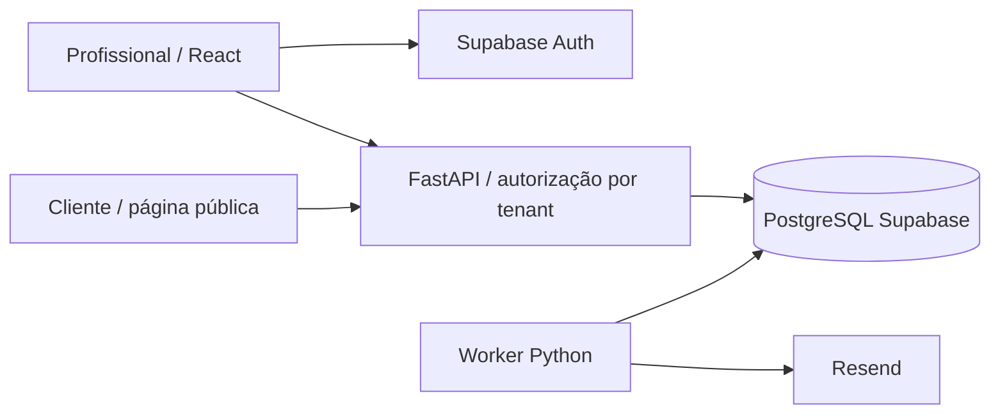

# Arquitetura e limites

## Base atual

Monorepo com SPA React/TypeScript/Vite/Tailwind/shadcn e API FastAPI independente.
A paleta usa grafite #272B35, bege #F7F3EF, destaque #9A746D e branco #FFFFFF.
O destaque não é usado como fundo de texto pequeno branco, para preservar contraste.
Estado demonstrativo em memória, sem localStorage de dados pessoais. Serviços ativos
alimentam os cartões públicos na mesma sessão. A área `/conta` implementa Auth Supabase
e perfil persistente via GET/PUT `/api/v1/me`, dependendo de configuração externa.
Nenhum projeto Supabase real foi conectado ainda. Ver `stage-2.md`.
Na Etapa 3, `/conta` também oferece catálogo persistente e prévia privada de
disponibilidade, com seleção de múltiplos serviços. Serviços e ocupações possuem
RLS; ocupações são somente leitura para a aplicação. A gravação de reservas e a
proteção transacional de sobreposição ficam na Etapa 4. Ver `stage-3.md`.
Na demonstração, personalização visual permanece em memória: cor principal/fundo e logo
normalizada para PNG no navegador. Variáveis CSS ficam restritas à página pública
e à prévia. Upload futuro deve repetir validação no servidor, limitar dimensões e
tamanho, reencodar imagens, usar caminhos vinculados ao tenant e políticas de Storage
que impeçam substituição de logos de outra conta. A validação local não substitui isso.
Perfil e expediente têm autorização por identidade e RLS no schema privado levia.
Na conta conectada, as cores são persistidas com o perfil; upload de logo ainda não.

SQLAlchemy 2 e Alembic implementam os modelos e a migração inicial de identidade,
expediente e rate limit. O cliente Supabase só é inicializado com configuração válida;
Resend e pagamento continuam sem integração. Logo permanece demonstrativa.
Dependências Python têm faixas compatíveis e um snapshot `requirements-dev.lock.txt`
do ambiente validado. Revisão de vulnerabilidades e lock por plataforma com hashes
são pendências antes do deploy. O lock npm é a referência do front-end.

## Fluxo alvo (identidade implementada; reservas e worker futuros)

Uma profissional por tenant/assinatura. Tenant deriva da identidade autenticada
e do vínculo no servidor; nunca de um tenant_id confiado ao navegador. Reservas
públicas terão um contrato reduzido e serão resolvidas pelo slug sem expor clientes.
O navegador não acessará tabelas de clientes diretamente.

## Segurança: direção arquitetural

JWT, RLS, papel restrito e limites já têm implementação e testes locais na Etapa 2.
Os itens abaixo também incluem exigências de produção ainda pendentes; a situação
detalhada e as limitações estão em `stage-2.md`.

- Validar JWT Supabase: assinatura/JWKS, issuer, audience e expiração. Não usar
  user_metadata editável como autorização. Tratar rotação de chaves e revogação.
- Todos os repositórios devem filtrar tenant, inclusive busca por ID, alteração,
  exclusão, histórico e jobs. Testes negativos entre dois tenants são obrigatórios.
- Papel de aplicação sem BYPASSRLS e diferente do dono das tabelas. RLS nas tabelas
  expostas e, quando adequado, no schema privado como defesa adicional. Contexto
  de tenant transacional, sem vazamento entre conexões do pool. Evitar service_role
  para operações comuns. Revogar grants desnecessários da Data API.
- CORS não é autorização. Limites por IP e tenant precisam funcionar entre réplicas;
  confiar em cabeçalhos de proxy somente quando o proxy for conhecido.
- Limitar payloads, paginação e automação abusiva; proteção específica para slots,
  reservas públicas e login. Respostas de erro sem SQL, tokens ou dados pessoais.
- TLS, gestão de segredos, rotação, backups e logs sem telefone/e-mail/tokens.
  Nenhum selo de produção segura é afirmado pela presente demonstração.

## Disponibilidade e transações (Etapas 3–4)

Persistir instantes em timestamptz/UTC e regras de expediente no fuso IANA da
profissional. Dinheiro em centavos inteiros. Guardar preço/duração do serviço como
snapshot da reserva, evitando alterações retroativas. Horários disponíveis derivados
de expediente, pausas, duração, bloqueios e reservas com status ocupante.

Uma reserva poderá conter vários serviços (itens com snapshots próprios). O servidor
deverá validar todos como ativos e pertencentes ao mesmo tenant, calcular o preço e
a duração somados e reservar um intervalo contínuo para o atendimento completo.
Não confiar nos totais do navegador. Alterar os itens exige recalcular disponibilidade
e revalidar a ocupação transacionalmente. Definir retornos por item na etapa de lembretes.
A demonstração já permite a seleção múltipla, mas seus horários são fictícios.

Usar intervalo semiaberto [início,fim) e exclusão GiST por tenant/intervalo para
reservas e bloqueios em uma mesma tabela de ocupação; confirmar suporte btree_gist.
Revalidar e inserir na mesma transação. Tratar conflito como 409, com idempotência
para repetição de requisições. Consultar disponibilidade não garante a reserva.

## Notificações (Etapa 5)

Outbox no PostgreSQL na transação de agendamento, worker Python com lease,
SKIP LOCKED, tentativas com backoff e recuperação após queda. Evitar scheduler
somente em memória ou acoplado ao processo web. Job único por reserva/tipo/versão;
cancelamento e reagendamento invalidam jobs antigos. Reservas feitas a menos de
24 horas precisam de regra explícita, sem lembrete retroativo duplicado.

Franquia mensal padrão 100 configurável por assinatura, com consumo/reserva atômicos,
chave idempotente no provedor e política de falha/reembolso definida. Painel informa
esgotamento; nunca bloquear a agenda por franquia de e-mail. Avisos transacionais e
convites de retorno são categorias distintas. Reconsultar autorização antes do envio.
WhatsApp somente por ação manual da profissional, nunca automação nesta versão.

## Privacidade e operação

Coletar apenas nome/telefone e e-mail opcional. Registro separado de opt-in para
convites (texto/versão, instante e origem), revogação e trilha mínima. Definir retenção,
exportação, exclusão e aviso de privacidade antes de aceitar dados reais. E-mails de
reserva não devem obrigar consentimento de marketing. Validar obrigações LGPD antes
do lançamento; esta documentação é direção técnica, não parecer jurídico.

Assinatura terá estado e permissões próprios, separados do adaptador de pagamentos.
Preço alvo R$ 19,90 não implica viabilidade comprovada: medir custo de banco, worker,
e-mails, observabilidade e suporte. Agendamentos sem limite comercial fixo, com
proteções contra abuso. Não ativar provedor nem plano pago nesta fase.
